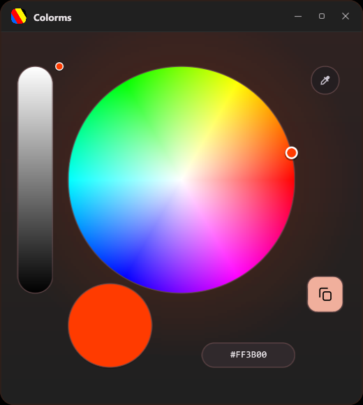

# Colorms

用 Rust + egui 做的 Material You 风格颜色制作器。界面按照 `ui.vectorcraft`
（576 × 576 画板）1:1 还原并随窗口等比缩放。



## 功能

- **圆形色盘**：角度选色相，半径选饱和度；滚轮区域外的角度也继续生效。
- **明度胶囊**：左侧黑白渐变竖条，顶部 100% 白色、底部 0% 黑色。
- **圆形预览**：左下角实时显示最终颜色。
- **十六进制值**：右下胶囊显示 `#RRGGBB`，点击即复制。
- **复制按钮**：右侧双层圆角卡片本身就是复制图标（无内嵌图标/文字）；
  点击复制当前色值，整个描边从灰色变为纯白色作为确认，上层卡片会遮住下层重叠部分。
- **最近颜色**：底部自动记录（最多 24 条，展示 12 个圆点）。
  点击圆点恢复，右键删除。
- **动态主题**：背景、复制按钮、描边随当前颜色生成 Material You 暗色配色。
- **无边框自适应窗口**：自定义标题栏 / 最小化 / 最大化 / 关闭，
  6px 边缘拖拽调整大小，圆角与透明背景。最底部固定为 `#202020`。

## 快捷键

| 按键 | 作用 |
| --- | --- |
| `Ctrl + C` | 复制当前颜色 |
| `Esc` | 关闭提示气泡 |

## 性能

冷启动按“进程启动 → 首帧”优化（本机热缓存测试，中位数约 300 ms）：

- 字体读取和 768² 色盘纹理生成放在后台线程，与 winit/GL 初始化重叠；首帧只负责上传纹理和绘制。
- 色盘纹理由 4096 阶色相 LUT + 白色混合生成，不再逐像素做 HSV 转换。
- 发布版使用 `lto = "fat"`、`codegen-units = 1`、`panic = "abort"`、`strip = true`，可执行文件约 5.3 MB。
- 使用 Windows 系统字体（Segoe UI / 等线 / Consolas），不内嵌字体资源。

## 技术栈

- GUI：`eframe` / `egui` 0.33.3（glow 后端，仅保留 glow feature，全自绘控件）
- 存储：`rusqlite` 0.37（bundled SQLite，WAL 模式）
- 序列化：`serde` / `serde_json`
- 错误处理：`thiserror`（数据层）+ `anyhow`（应用层）
- 日志：`tracing` + `tracing-appender`（按天滚动）
- 测试：`cargo test`（21 个单元测试）+ `criterion`（核心色彩路径）

## 构建与运行

需要 Rust 1.88+ 和可用的 C 工具链（`rusqlite` 的 bundled SQLite 需要 `cc`）。
Windows 上可以用 MSVC Build Tools，或者 GNU 目标 + w64devkit。
当前主要针对 Windows（透明无边框窗口、系统字体加载按 Windows 调优）。

```powershell
cargo run            # 开发运行
cargo test           # 单元测试
cargo bench --bench color
cargo build --release
```

生成的可执行文件：

- 调试版：`target\debug\colorms.exe`
- 发布版：`target\release\colorms.exe`

## 数据位置

- 数据库：`%APPDATA%\Colorms\colorms.db`（WAL）
- 日志：`%APPDATA%\Colorms\logs\colorms.log.YYYY-MM-DD`

数据库不可用时应用会自动回退到内存数据库，并在窗口内提示。

## 目录

```
src/
  main.rs    启动、窗口选项、日志与数据库初始化
  app.rs     eframe::App：绘制、交互、持久化、toast
  ui.rs      布局/度量、色盘与明度纹理、图标与背景绘制
  color.rs   色彩模型（HSV / hex / 对比度 / Material 色）
  theme.rs   动态 Material You 暗色主题
  db.rs      SQLite（WAL）、最近颜色、设置
benches/
  color.rs   criterion 基准
assets/      窗口图标原始 RGBA
ui.svg / ui.vectorcraft / ui.png
            设计稿
```
